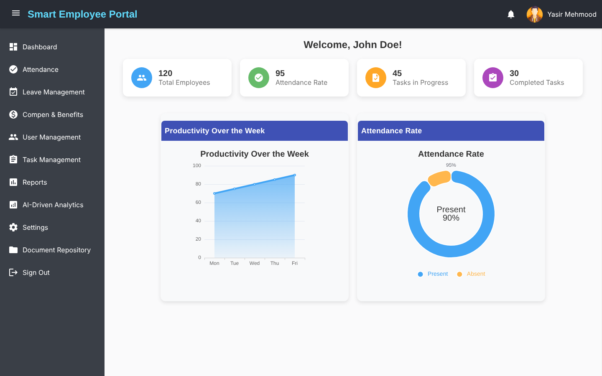

# 🖥️ Smart Employee Portal — Frontend

> Angular 17 UI for the **Smart Employee Portal**, an HR and attendance platform. Built with **standalone components**, **lazy-loaded feature routes**, **Angular Material** and **ECharts**, with webcam capture for face-recognition attendance.

[](https://angular.dev)
[](https://www.typescriptlang.org)
[](https://material.angular.io)
[](https://github.com/yasirmalik36/smart-employee-portal-frontend/actions/workflows/ci.yml)
[](LICENSE)

> **Status:** work in progress. The app shell, routing, account screens, dashboard widgets and webcam attendance capture are in place; several feature modules (AI analytics, reports, documents) are still placeholders.

---

## 📸 Screenshots

**Dashboard**: headcount, attendance and task stats with weekly productivity and attendance charts.



**Sign in**


## ✨ What's inside

| Area | Details |
|---|---|
| 🔐 **Account** | Login, register, profile, forgot / reset password screens |
| 🧭 **App shell** | Material sidenav layout with lazy-loaded feature routes under `/home` |
| 📊 **Dashboard** | Reusable stats cards plus line and donut charts (ECharts via `ngx-echarts`) |
| 📸 **Attendance** | Webcam capture with `ngx-webcam` for face-recognition check-in |
| 🗂️ **Feature modules** | Leave management, compensation & benefits, user management, task management, reports, documents, notifications, settings |

### Project structure

```
src/app/
├── account/        # login, register, profile, password flows
├── core/           # guards, interceptors, services (scaffolded)
├── features/       # lazy-loaded feature pages
├── layout/         # Material sidenav shell
├── shared/         # stats-card, line-chart, donut-chart, Material module
├── app.routes.ts   # route table (loadComponent per feature)
└── app.config.ts   # providers: router, animations, ECharts
```

---

## 🚀 Getting started

```bash
git clone https://github.com/yasirmalik36/smart-employee-portal-frontend.git
cd smart-employee-portal-frontend
npm ci
npm start            # ng serve → http://localhost:4200
```

| Command | What it does |
|---|---|
| `npm start` | Dev server with live reload |
| `npm run build` | Production build to `dist/` |
| `npm test` | Karma + Jasmine (no specs written yet) |

---

## 🔗 Related repositories

- [smart-employee-portal-backend](https://github.com/yasirmalik36/smart-employee-portal-backend) — .NET 8 Web API (JWT auth, attendance, employees)
- [smart-employee-portal-face-recognition](https://github.com/yasirmalik36/smart-employee-portal-face-recognition) — FastAPI + DeepFace + FAISS face verification

## 🗺️ Roadmap

- Wire feature pages to the .NET API through a typed `HttpClient` service and auth interceptor
- Re-enable the route guard once login is connected
- Add unit tests for shared components

## 📄 License

MIT — see [LICENSE](LICENSE).

---

<div align="center">

Built by **[Yasir Mehmood](https://yasir-portfolio-omega.vercel.app)** · [LinkedIn](https://linkedin.com/in/yasir-mehmood-53549a1b3) · [GitHub](https://github.com/yasirmalik36)

</div>
