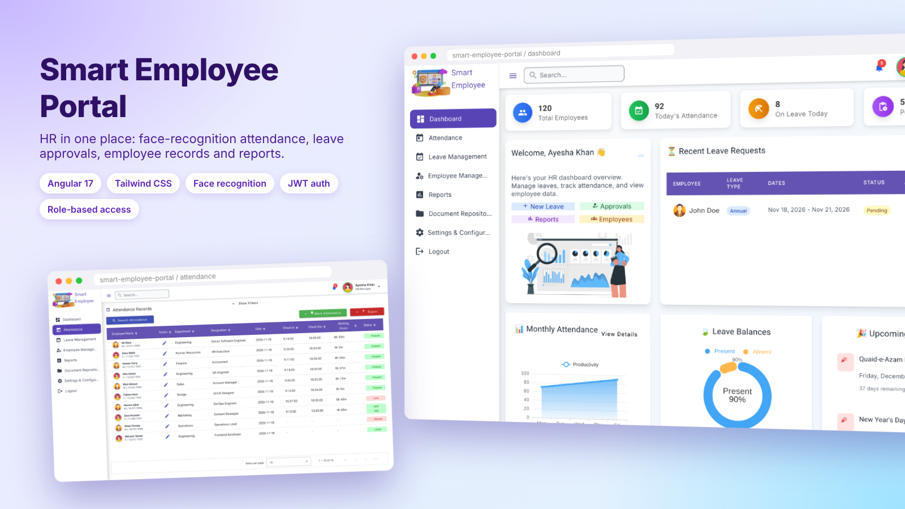
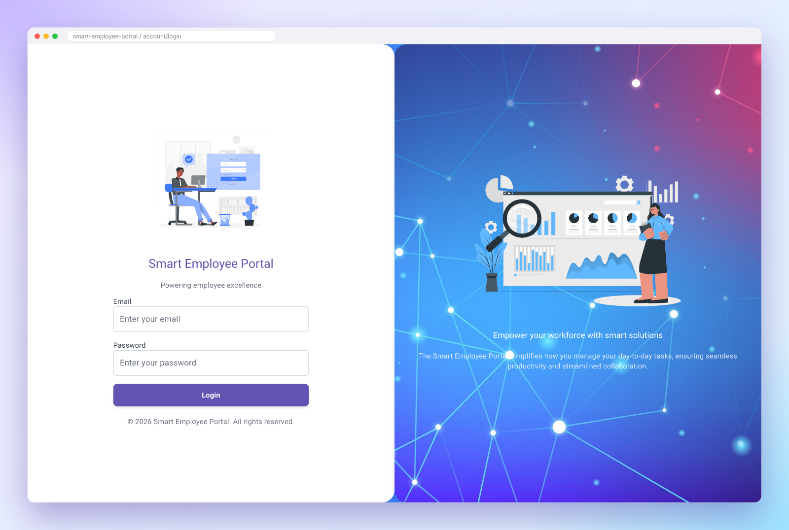
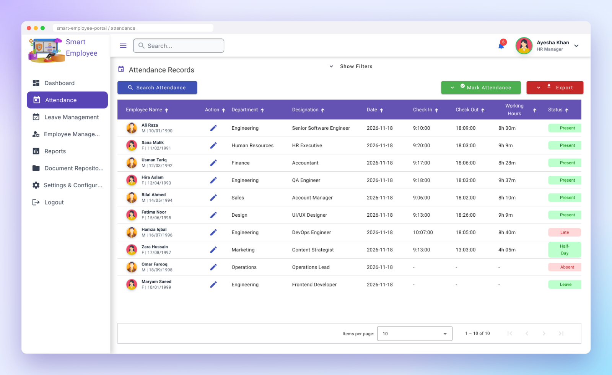
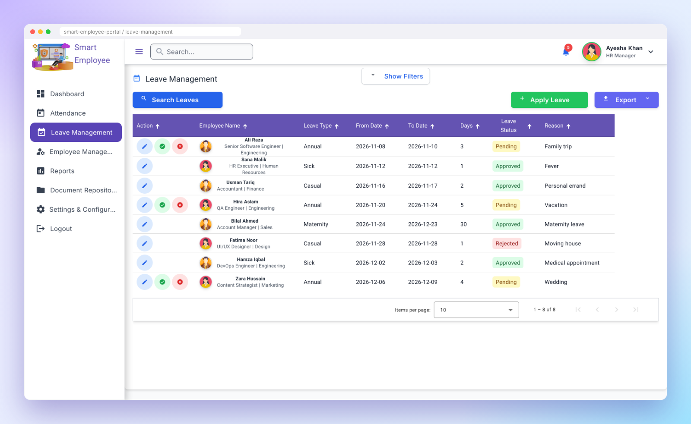
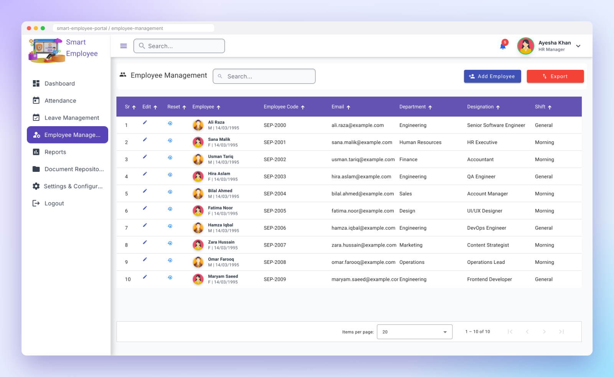
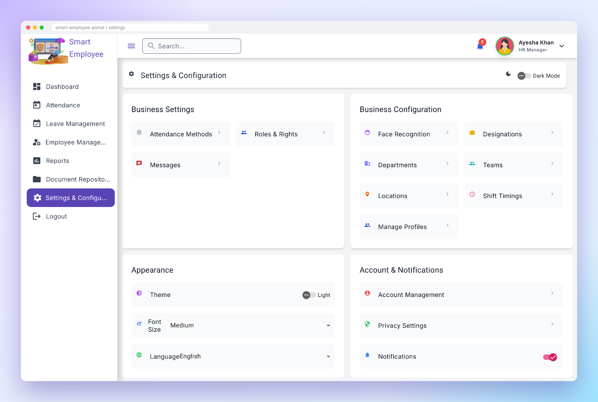

# 🖥️ Smart Employee Portal — Frontend

> Angular 17 UI for the **Smart Employee Portal**, an HR and attendance platform: face-recognition attendance, leave requests and approvals, employee records, reports and settings. Built with **standalone components**, **lazy-loaded feature routes**, **Tailwind CSS** and **Angular Material**.

[](https://angular.dev)
[](https://www.typescriptlang.org)
[](https://tailwindcss.com)
[](https://material.angular.io)
[](https://github.com/yasirmalik36/smart-employee-portal-frontend/actions/workflows/ci.yml)
[](LICENSE)



---

## 📸 Screenshots

> Captured from the running app with fictional sample data. All names and emails are made up.

| Sign in | Dashboard |
|---|---|
|  |  |
| **Attendance** | **Leave management** |
|  |  |
| **Employees** | **Settings & configuration** |
|  |  |

## ✨ What's inside

| Area | Details |
|---|---|
| 🔐 **Account** | JWT login, change password, route guard, and a token interceptor that adds the bearer token to API calls |
| 📊 **Dashboard** | Headcount, attendance, leave and approval stats; monthly attendance and leave charts; upcoming public holidays |
| 📸 **Attendance** | Face-recognition check-in from the webcam, manual attendance, filters, pagination and Excel export |
| 🌴 **Leave management** | Apply, approve, reject and cancel leave; leave balances, supporting documents, and Excel / PDF export |
| 👥 **Employees** | Employee directory, add / edit profiles, password reset and profile view |
| 📑 **Reports** | Generate attendance, leave and performance reports by date range, department and employee |
| ⚙️ **Settings** | Face-recognition enrolment (face-api.js), departments, designations, teams, shifts, locations, roles and rights |
| 📁 **Documents** | Document repository page |

### Project structure

```
src/app/
├── account/        # login and password flows, auth service
├── common/         # guards, interceptors, export helpers, shared services, pipes
├── features/       # attendance, leaves, employee, dashboard, reports, settings, documents, tasks
├── layout/         # sidebar + top bar shell
├── shared/         # reusable components and the Material module
├── models/         # shared TypeScript models
├── app.routes.ts   # route table (guarded /home with lazy-loaded feature routes)
└── app.config.ts   # providers: router, HTTP interceptors, animations, charts
```

---

## 🚀 Getting started

```bash
git clone https://github.com/yasirmalik36/smart-employee-portal-frontend.git
cd smart-employee-portal-frontend
npm ci
npm start            # ng serve → http://localhost:4200 (expects the .NET API at https://localhost:7162)
```

| Command | What it does |
|---|---|
| `npm start` | Dev server with live reload |
| `npm run build` | Production build to `dist/` |
| `npm test` | Karma + Jasmine (no specs written yet) |

---

## 🔗 Related repositories

- [smart-employee-portal-backend](https://github.com/yasirmalik36/smart-employee-portal-backend) — .NET 8 Web API (JWT auth, attendance, employees)
- [smart-employee-portal-face-recognition](https://github.com/yasirmalik36/smart-employee-portal-face-recognition) — FastAPI + DeepFace + FAISS face verification

## 🗺️ Roadmap

- Load public holidays (including lunar holidays such as Eid) from the API
- Replace the dashboard's sample figures with live data from the API
- Add unit tests for shared components and services

## 📄 License

MIT — see [LICENSE](LICENSE).

---

<div align="center">

Built by **[Yasir Mehmood](https://yasir-portfolio-omega.vercel.app)** · [LinkedIn](https://linkedin.com/in/yasir-mehmood-53549a1b3) · [GitHub](https://github.com/yasirmalik36)

</div>
